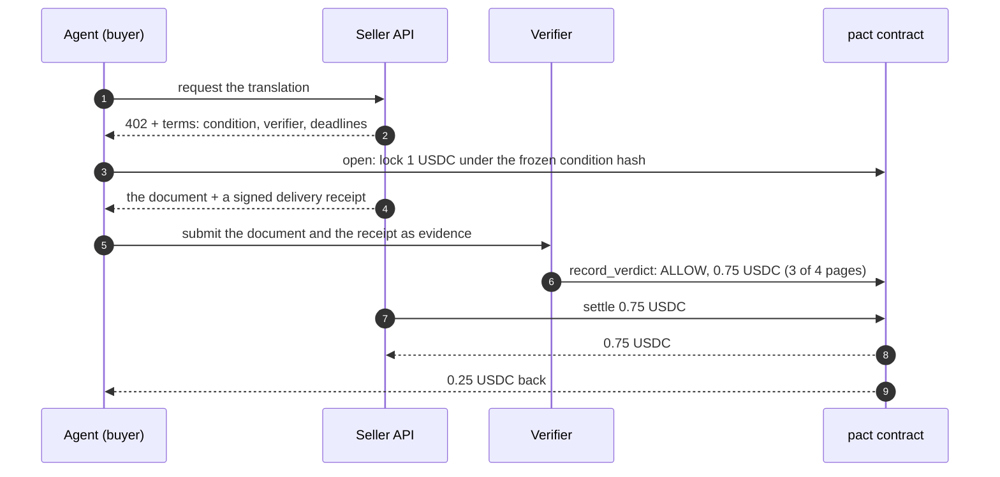
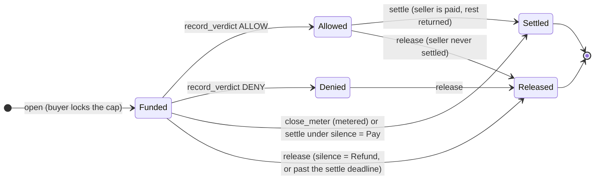

<p align="center">
  <picture>
    <source media="(prefers-color-scheme: dark)" srcset="brand/pactwright-logo-dark.svg">
    
  </picture>
</p>

<p align="center">
  <b>Escrow for AI-agent purchases on Stellar.</b><br>
  The buyer's money moves only when delivery is proven. Otherwise it comes back.
</p>

<p align="center">
  <a href="https://github.com/Pactwright/Pactwright-contracts/actions/workflows/ci.yml"></a>
  <a href="LICENSE"></a>
  <a href="https://scorecard.dev/viewer/?uri=github.com/Pactwright/Pactwright-contracts"></a>
</p>

<p align="center">
  <a href="https://pactwright.github.io/docs/"><strong>Documentation</strong></a> ·
  <a href="#-quick-start"><strong>Quick start</strong></a> ·
  <a href="#-benchmarks"><strong>Evidence</strong></a>
  <!-- demo: add a Docs · Dashboard · Demo link row here when a screencast or dashboard exists -->
</p>

> [!IMPORTANT]
> **Testnet only, not audited.** The `pact` contract is live on Stellar testnet and every number
> below links to a real transaction or to the file that recorded it. Nothing here is on mainnet, and
> no external audit has been performed; do not use it with real funds until the audit (ROADMAP
> P8-01). The safest first read is [docs/SECURITY_MODEL.md](docs/SECURITY_MODEL.md).

| | |
|---|---|
| `pact` contract (testnet) | [`CDUXJJUN…MFEV6`](https://stellar.expert/explorer/testnet/contract/CDUXJJUNYFILEYHE3LITANJEKCDFERNAABOSG75OWATFVM776BCMFEV6) |
| Its WASM hash | [`748b5dbcc800…35d1a4`](DEPLOYMENTS.md), identical in the [release](https://github.com/Pactwright/Pactwright-contracts/releases/tag/v0.1.0-rc.1), on testnet and in a local build |
| Receipt anchor (testnet) | [`CAEO5GBC…LNJ2`](https://stellar.expert/explorer/testnet/contract/CAEO5GBC3ULRC5RYBSCSOXLNXHU2HZAHNW5HY5LZM3DIPFMX357ILNJ2), Accensa `ReceiptAnchor` v0.2.0 |
| Payment token | USDC ([`CBIELTK6…DAMA`](https://stellar.expert/explorer/testnet/contract/CBIELTK6YBZJU5UP2WWQEUCYKLPU6AUNZ2BQ4WWFEIE3USCIHMXQDAMA), Circle testnet) |
| Measured cost | [docs/BENCHMARKS.md](docs/BENCHMARKS.md): local and real-transaction numbers per call |
| Trust model | [docs/SECURITY_MODEL.md](docs/SECURITY_MODEL.md) |
| Documentation | [pactwright.github.io/docs](https://pactwright.github.io/docs/), including the [contract API reference](https://pactwright.github.io/docs/reference/contract/) |
| Design | [PRD](docs/PRD.md) · [Architecture](docs/ARCHITECTURE.md) · [15 ADRs](docs/adr/) |
| License | [MIT](LICENSE), with every third-party license listed |

## 📖 Overview

This repository is the on-chain half of Pactwright: the `pact` Soroban escrow contract for
purchases an AI agent makes. The buyer locks a cap. A verifier's signed verdict — or, for metered
services, the buyer's own signed usage — decides how much the seller gets. The rest returns to the
buyer. No admin can move those funds, and no counterparty's cooperation is required to get money
back once a verdict says DENY.

AI agents already buy things on their own: an API call, a translated document, a dataset, minutes of
compute. On Stellar they can already pay with [x402](https://developers.stellar.org/docs/build/agentic-payments/x402):
the seller answers `402 Payment Required`, the agent pays in USDC and retries. That covers *paying*.
It does not cover what happens when the purchase goes wrong, and an agent has no one to call. So the
rules for getting money back have to be inside the payment itself. That is what a pact is.

Everything below is what this repo actually contains and actually proves: the contract and its API,
the invariants and test vectors that pin its behaviour, the cost limits enforced in CI and measured
on real transactions, and the testnet evidence. **What is not real here:** there is no mainnet
deployment, no audit report, and no M1 `upto` mode — the lighter M0 refund mode is real, but it
lives in the seller's middleware, not in this contract. Full documentation lives at
[pactwright.github.io/docs](https://pactwright.github.io/docs/).

The SDK, seller middleware and verifier live in
[Pactwright-Kit](https://github.com/Pactwright/Pactwright-Kit); pact pages and receipt anchoring live
in [Pactwright-studio](https://github.com/Pactwright/Pactwright-studio).

### 🏗️ Architecture

The workspace has three crates, a vendored dependency and the scripts that bind them together, all
in one repo:

1. **`contracts/pact` — the escrow contract** ([manifest](contracts/pact/Cargo.toml), `publish = false`)
   - Nine entrypoints: `open`, `record_verdict`, `settle`, `close_meter`, `release`, `set_verifier`,
     `get_pact`, `get_config`, `extend_pact_ttl`, plus the deploy-time `__constructor`.
   - `lifecycle.rs` moves USDC through the Stellar Asset Contract and enforces the two deadlines;
     `verdict.rs` and `meter.rs` verify ed25519 signatures; `hashing.rs` is the only place a hash is
     computed.
   - Amounts are `i128` stroops; every failure aborts with a named `panic_with_error!` code.
2. **`test-vectors/` — the source of truth for every hash** ([README](test-vectors/README.md))
   - Eight vector files, generated from the contract's own hashing code by `scripts/gen_vectors.sh`
     and never edited by hand; `cargo test` fails when a committed file drifts from the code.
     The one documented exception is `condition_hash.json`, which comes from the Kit's canonical-JSON
     hashing (ADR-015) and is treated as opaque bytes here.
   - The same files are consumed by the TypeScript SDK in Pactwright-Kit, so both implementations are
     pinned to one encoding.
3. **`tools/pact-sign` — off-chain signing** ([manifest](tools/pact-sign/Cargo.toml))
   - Produces pact IDs, verdict attestations and usage vouchers using the contract crate as a library,
     so a test signature and an on-chain-verifiable signature come from the same code path.
4. **`contracts/testutils` and `vendor/wasm` — real counterparties in tests** ([`SHA256SUMS`](vendor/wasm/SHA256SUMS))
   - Pinned, hash-checked Accensa `ReceiptAnchor` and `RefundVault` v0.2.0 WASMs, used in integration
     tests so receipts are verified against the contract that will check them in production.
5. **`scripts/` and `.github/workflows/` — the two cost tiers**
   - `scripts/build.sh` prints the WASM hash — the same sha256 the on-chain deployment carries, which
     [DEPLOYMENTS.md](DEPLOYMENTS.md) records; `scripts/bench-testnet.sh` runs every entrypoint as a
     real testnet transaction, and `--check` fails the run when a recorded limit in
     [budget.toml](budget.toml) is exceeded.

### 🧪 Invariants, vectors and budget tests

What the test suite catches:

- **Eight named invariants**, each tied to a test in
  [docs/INVARIANTS.md](docs/INVARIANTS.md) — including "no entrypoint lets the admin move funds or
  change an open pact" (invariant 4) and "`paid_to_seller + returned_to_buyer == cap` at the terminal
  state" (invariant 2). Run them with `cargo test invariant`.
- **Property and fuzz targets** (`bolero`), including amounts always summing to the cap and deadlines
  never trapping. Run them with `cargo test fuzz` (see [`fuzz/README.md`](fuzz/README.md)).
- **Byte-for-byte vectors** for `pact_id`, `condition_hash`, verdict, usage voucher, delivery receipt,
  receipt leaf and Merkle root, asserted by the contract crate and by the TypeScript SDK.
- **Integration against the real Accensa WASMs**: a receipt verifies in `ReceiptAnchor`; an M0 refund
  happens once per `pact_id`.
- **Budget tests on every entrypoint** ([`contracts/pact/src/test/budget.rs`](contracts/pact/src/test/budget.rs)),
  running the compiled WASM, with limits set at measured × 1.15
  ([Tollcraft `budget-macros`](https://github.com/Tollcraft/soroban-budget-assert), pinned by commit
  in [contracts/pact/Cargo.toml](contracts/pact/Cargo.toml)). A cost regression fails CI rather than
  appearing on the network, and the Tollcraft cost-lint gate in
  [`.github/workflows/cost-lint.yml`](.github/workflows/cost-lint.yml) must pass on every pull request.

Measured 2026-10-30 with `cargo test --workspace`: **90 passed, 0 failed** — 86 in the contract
suite, 4 in the tool suite. No test is ignored.

What these tests cannot see: they run against Pactwright's own verifier key and fixture deliveries,
not against adversarial or arbitrary real-world conditions, and they do not exercise the x402
facilitator path (that lives in Pactwright-Kit). Nothing here is an audit.

### Why a pact instead of a refund

| Without Pactwright | With a pact |
|---|---|
| Money moves before anything is delivered | The cap sits in escrow until a verdict or signed usage |
| "Delivered" is whatever the seller's server says | A verifier checks the delivery against a condition frozen before payment |
| A wrong delivery needs the seller's goodwill to refund | DENY returns the escrow; no one's permission needed |
| A silent seller or verifier can hold funds forever | Deadlines and an agreed silence policy release funds automatically |
| Pay-per-minute services charge up front | The buyer signs cumulative usage; the seller is paid for exactly that |
| Receipts live on the seller's server | Every outcome is anchored on-chain and verifiable by anyone |

### Key ideas in plain language

| Term | Meaning |
|---|---|
| **Pact** | One purchase held in escrow. Its `pact_id` is derived from the buyer, the seller, a nonce and the condition, so no one else can claim it. |
| **Cap** | The most the buyer can pay. It is locked in the contract when the pact opens. |
| **Condition** | What "delivered correctly" means, written down before payment (for example "a Portuguese translation of at least 4 pages"). Only its hash goes on-chain, so it can never change later. |
| **Verifier** | A service that checks the delivery against the condition and signs a verdict. Its key is fixed in the pact when the pact opens. |
| **Verdict / attestation** | The verifier's signed decision: ALLOW with an amount (which may be less than the cap, for partial delivery) or DENY. |
| **Settle** | The seller collects the allowed amount. The rest of the cap goes back to the buyer in the same transaction. |
| **Release** | The whole cap goes back to the buyer: after a DENY, after a silent verifier, or after the seller missed the settle deadline. |
| **Deadlines** | `verdict_deadline` is the last ledger for a verdict; `settle_deadline` is the last ledger for the seller to collect. A ledger closes about every 5 seconds. |
| **Silence policy** | Agreed at open. If no verdict arrives by the verdict deadline, either refund the buyer (`Refund`, the default) or let the seller collect (`Pay`). |
| **Metered pact** | Pay per unit (minutes, pages, calls). The buyer signs a running total of units used, and the seller collects for that total. No verifier is involved. |
| **Receipt** | A hash of each final outcome. Receipts are batched into a Merkle tree and anchored on-chain, so anyone can prove what happened. |

Amounts are in stroops of the payment token. USDC has 7 decimals, so `10_000_000` = 1 USDC.

### A purchase, step by step

An agent buys a document translation for at most **1 USDC**. The seller's price depends on the
number of pages actually delivered.



1. **Terms.** The seller's `402` response names the condition, the verifier and the deadlines. The agent can read them before paying anything.
2. **Open.** The agent calls `open`. The contract checks the cap, the deadlines and that buyer ≠ seller. It moves 1 USDC into escrow and stores the verifier key that will judge this pact.
3. **Delivery.** The seller sends the document with a signature over its exact bytes, so neither side can later pretend something else was delivered.
4. **Verdict.** The verifier reads the delivery, applies deterministic rules and signs an attestation: ALLOW 0.75 USDC, because only 3 of 4 pages arrived. Anyone can submit it; the signature is what counts.
5. **Settle.** The seller collects 0.75 USDC, and the contract returns 0.25 USDC to the agent in the same transaction.
6. **Receipt.** The outcome is hashed into a receipt and anchored, so the agent can prove later exactly what it paid for.

If the verifier had said DENY, step 5 would be a `release` instead and the agent would get the full 1 USDC back.

A **metered** purchase (say, minutes of GPU time) skips the verifier. The agent signs vouchers
like "usage so far: 500 units" as it consumes. When the session ends, the seller calls
`close_meter` with the latest voucher and is paid `500 × unit_price`. The rest of the cap returns
to the agent.

### How a pact moves through its life



Every pact ends in exactly one terminal state, `Settled` or `Released`. In both, the amount paid
to the seller plus the amount returned to the buyer equals the cap. These are two of the eight
[invariants](docs/INVARIANTS.md), and each invariant is enforced by a named test.

### Two protection modes

Pactwright offers buyers two levels of protection. This repository implements the stronger one.
There is no third mode: an "up to" partial-payment mode was considered and deliberately not built.

| | M0: exact refund | M2: escrow (this contract) |
|---|---|---|
| Where the money waits | Paid to the seller immediately | Locked in the `pact` contract |
| Who decides a refund | The seller, through its Accensa `RefundVault` | A verifier's signed verdict, or the buyer's signed usage |
| Needs the seller's cooperation | Yes | No |
| Best for | Cheap, high-volume calls from trusted sellers | Larger or one-off purchases, new sellers |
| Lives in | Pactwright-Kit (seller middleware) | `contracts/pact` |

### Who does what, and who you have to trust

| Role | Can | Cannot |
|---|---|---|
| **Buyer** | Open a pact (locks its own money); sign usage vouchers for metered pacts | Take the escrow back outside the release rules |
| **Seller** | Settle up to the allowed amount; close a meter for the signed usage | Collect more than the verdict or the usage allows |
| **Verifier** | Sign one verdict per pact | Move funds; change a pact |
| **Admin** | Rotate the verifier key for **new** pacts | Move funds; change any open pact |
| **Anyone** | Submit a valid verdict; call `release` when allowed; extend a pact's storage TTL | Send funds anywhere but to the buyer or seller |

In short, the buyer trusts only the verifier named in the pact, and the seller trusts the same
verifier to have checked honestly. Neither has to trust the admin or the other party. The full
analysis is in [docs/SECURITY_MODEL.md](docs/SECURITY_MODEL.md).

### When things go wrong

| Situation | What happens |
|---|---|
| The delivery is wrong | The verifier signs DENY, anyone calls `release`, and the buyer gets the full cap back. |
| Only part was delivered | The verifier signs ALLOW with a smaller amount. The seller collects that and the rest returns. |
| The seller never delivers | No verdict arrives. With the default `Refund` policy, anyone can `release` after the verdict deadline. |
| The verifier goes offline | Same as above: the agreed silence policy applies at the verdict deadline. |
| The seller never collects | After the settle deadline anyone can `release`, so the money isn't stuck with an absent seller. |
| Someone submits a second, different verdict | Rejected: a pact accepts exactly one verdict. |
| A verdict meant for another pact is replayed | Rejected: attestations are bound to one `pact_id` and condition hash. |
| The verifier key leaks | The admin rotates the key for new pacts. Existing pacts are exposed only until their verdict deadline. |
| The issuer freezes the buyer's USDC | `release` can't pay a frozen account, so funds stay in escrow until the freeze lifts (a known limit). |

### Contract API

| Function | Who calls it | What it does |
|---|---|---|
| `__constructor(admin, token, verifier, max_pact_ledgers)` | Deployer, once | Sets the admin, the payment token, the first verifier key and the longest allowed pact |
| `open(params) → pact_id` | Buyer | Locks `cap` in escrow, snapshots the verifier key, stores the deadlines and silence policy |
| `record_verdict(pact_id, attestation, signature)` | Anyone | Records the single ALLOW/DENY verdict after checking the verifier's signature |
| `settle(pact_id, actual)` | Seller | Pays `actual` (≤ allowed) to the seller and returns the rest to the buyer |
| `close_meter(pact_id, units, signature)` | Seller | Pays `units × unit_price` from the buyer's signed voucher and returns the rest |
| `release(pact_id)` | Anyone | Returns the whole cap to the buyer when the release rules allow it |
| `set_verifier(key)` | Admin | Changes the verifier key for pacts opened afterwards |
| `get_pact(pact_id)`, `get_config()` | Anyone | Read a pact or the contract configuration |
| `extend_pact_ttl(pact_id)` | Anyone | Keeps an open pact's storage alive |

Every state change emits a typed event, listed in [docs/EVENTS.md](docs/EVENTS.md). The exact
byte encoding of IDs and signed messages is in [ARCHITECTURE.md §4.3](docs/ARCHITECTURE.md) and
pinned by [`test-vectors/`](test-vectors), which the TypeScript SDK tests against too.

### Error codes

A failed call returns `Error(Contract, #n)` ([`contracts/pact/src/errors.rs`](contracts/pact/src/errors.rs)):

| # | Name | Meaning |
|---|---|---|
| 1 | `NotInitialized` | The contract has no configuration |
| 2 | `AlreadyExists` | A pact with this `pact_id` already exists |
| 3 | `PactNotFound` | No pact with this `pact_id` |
| 4 | `InvalidState` | The pact isn't in a state that allows this call |
| 5 | `InvalidAmount` | Amount is zero, negative, or above the cap or the allowed amount |
| 6 | `SelfDealing` | Buyer and seller are the same address |
| 7 | `BadDeadlines` | Deadlines are in the past, out of order, or beyond the allowed length |
| 8 | `VerdictWindowClosed` | The verdict deadline has passed |
| 9 | `SettleWindowClosed` | The settle deadline has passed |
| 10 | `NotReleasable` | The release conditions aren't met yet |
| 11 | `AttestationMismatch` | The attestation is for another pact or condition |
| 12 | `BadSignature` | Reserved. A bad signature aborts the transaction instead, because `ed25519_verify` traps |
| 13 | `NotMetered` | `close_meter` on a pact without metering |
| 14 | `IsMetered` | Verdict or settle on a metered pact |
| 15 | `Unauthorized` | The caller isn't allowed to do this |

### What the contract does today

| Capability | Status |
|---|---|
| Escrow a capped purchase in USDC | Testnet |
| Verdict-gated settlement, partial amounts, single verdict per pact | Testnet |
| Pay-per-unit metering with signed usage vouchers | Testnet |
| Verdict and settle deadlines with a silence policy (refund or pay) | Testnet |
| Receipts anchored in `ReceiptAnchor` and verified against it | Tested (integration) |
| Admin cannot move funds or change an open pact | Tested (invariant 4) |
| Reproducible build: release = deployment = local build | Proven |
| Per-call cost limits enforced in CI and on real transactions | Proven |
| Mainnet | After the audit |

### Security and known limits

- **Not audited.** Testnet only until the audit (ROADMAP P8-01).
- **No admin path to funds**, tested as [invariant 4](docs/INVARIANTS.md).
- **Signatures are domain-separated** (`pactwright-verdict-v1:`, `pactwright-usage-v1:`, …, defined in
  [`hashing.rs`](https://github.com/Pactwright/Pactwright-contracts/blob/cd151bdf8bce48f9fe027eb64efee5fdd6f7ae27/contracts/pact/src/hashing.rs#L14)), so one can never be replayed as another.
- **Known limits:**
  - A frozen buyer trustline blocks `release`.
  - The admin key itself can't be changed in this version; losing it only blocks verifier rotation, never funds.
  - The M0 refund mode lives outside this contract and depends on the seller.
- Report vulnerabilities privately, as described in [SECURITY.md](SECURITY.md).

### Stellar, specifically

| Stellar feature | Line of code |
|---|---|
| USDC moved into escrow through the Stellar Asset Contract | [lifecycle.rs:62](https://github.com/Pactwright/Pactwright-contracts/blob/cd151bdf8bce48f9fe027eb64efee5fdd6f7ae27/contracts/pact/src/lifecycle.rs#L62) |
| `ed25519_verify` on the verifier's attestation | [verdict.rs:50](https://github.com/Pactwright/Pactwright-contracts/blob/cd151bdf8bce48f9fe027eb64efee5fdd6f7ae27/contracts/pact/src/verdict.rs#L50) |
| `ed25519_verify` on the buyer's usage voucher | [meter.rs:49](https://github.com/Pactwright/Pactwright-contracts/blob/cd151bdf8bce48f9fe027eb64efee5fdd6f7ae27/contracts/pact/src/meter.rs#L49) |
| Storage TTL extended past the settle window, so funds never sit in an archived entry | [lifecycle.rs:87](https://github.com/Pactwright/Pactwright-contracts/blob/cd151bdf8bce48f9fe027eb64efee5fdd6f7ae27/contracts/pact/src/lifecycle.rs#L87) |
| Deadlines checked against the network's `max_ttl` | [lifecycle.rs:47](https://github.com/Pactwright/Pactwright-contracts/blob/cd151bdf8bce48f9fe027eb64efee5fdd6f7ae27/contracts/pact/src/lifecycle.rs#L47) |
| Release pays only the buyer, with no auth required | [lifecycle.rs:176](https://github.com/Pactwright/Pactwright-contracts/blob/cd151bdf8bce48f9fe027eb64efee5fdd6f7ae27/contracts/pact/src/lifecycle.rs#L176) |
| Domain-separated digests (verdict, usage, delivery, receipt) | [hashing.rs:14](https://github.com/Pactwright/Pactwright-contracts/blob/cd151bdf8bce48f9fe027eb64efee5fdd6f7ae27/contracts/pact/src/hashing.rs#L14) |
| Typed events with `#[contractevent]` | [events.rs:17](https://github.com/Pactwright/Pactwright-contracts/blob/cd151bdf8bce48f9fe027eb64efee5fdd6f7ae27/contracts/pact/src/events.rs#L17) |

Why Stellar: sub-cent fees make per-purchase escrow viable, and USDC is native through the
Stellar Asset Contract. Soroban's predictable resource model also lets every call carry a
measured cost limit.

### FAQ

**Why not just let the seller refund?** Then a refund depends on the seller. Pactwright supports
that lighter mode too (M0, through the seller's refund vault). This contract is the mode where
neither side has to trust the other.

**Who runs the verifier?** For now, Pactwright does. The verifier's key is fixed per pact, and
its verdicts follow the open [Witness](https://github.com/fabian416/witness) envelope format. It
can only sign verdicts; it can never move funds.

**Can a verdict be wrong?** Yes. That is why the condition is frozen before payment, the verdict
is bound to it, and partial amounts exist. Verifier dispute milestones are planned for v1
(ROADMAP P7-05).

**What does an agent need to hold?** Only USDC. Account reserves can be sponsored, and network
fees for these calls are fractions of a cent.

**Can I reuse this code?** Yes, under the MIT license (see [License](#license)). It is unaudited,
so read the [security model](docs/SECURITY_MODEL.md) first.

## 📊 Benchmarks

Two tiers, both in [docs/BENCHMARKS.md](docs/BENCHMARKS.md), both measured on the deployed WASM
`748b5dbcc800…35d1a4` on 2026-10-28 (soroban-sdk 28.0.0, stellar-cli 28.1.0).

**Tier A — local, WASM mode, CI-blocking.** Each test resets the budget immediately before the call
and asserts the call alone.

| Entrypoint | Path measured | CPU instructions | Memory bytes | CPU limit | Memory limit |
|---|---|---|---|---|---|
| `open` | escrow transfer in | 889,745 | 1,436,284 | 1,030,000 | 1,660,000 |
| `record_verdict` | ed25519 check + state write | 1,122,084 | 1,362,925 | 1,300,000 | 1,570,000 |
| `settle` | partial: two transfers (worst case) | 1,073,058 | 1,475,617 | 1,240,000 | 1,700,000 |
| `settle` | full: one transfer | 889,671 | 1,438,667 | — | — |
| `release` | full refund, one transfer | 872,907 | 1,423,341 | 1,010,000 | 1,640,000 |
| `close_meter` | ed25519 check + two transfers | 1,560,061 | 1,484,463 | 1,800,000 | 1,710,000 |

**Tier B — real testnet transactions.** `scripts/bench-testnet.sh` runs each entrypoint as a real
transaction on a dedicated bench deployment with a test token (bench `pact`
`CBWEAVYZD6SP3PA5V6ZGEBHBUYJENBAAG5CFBTB6FCYDYZGPYRZZQEQM`, recorded in
[DEPLOYMENTS.md](DEPLOYMENTS.md)), and reads the declared resources and charged fees back from RPC.
Raw report: [`docs/benchmarks/2026-10-28-testnet.json`](docs/benchmarks/2026-10-28-testnet.json).

| Call | Instructions | vs. Tier A | Fee charged (stroops XLM) | ≈ XLM |
|---|---|---|---|---|
| `open` | 1,071,584 | +20% | 181,442 | 0.0181 (includes storage rent) |
| `record_verdict` | 1,647,891 | +47% | 8,791 | 0.0009 |
| `settle` (partial) | 1,191,764 | +11% | 12,059 | 0.0012 |
| `release` | 1,032,490 | +18% | 8,750 | 0.0009 |
| `close_meter` | 2,039,236 | +31% | 12,694 | 0.0013 |

Against the per-transaction ceilings recorded in [budget.toml](budget.toml) (CPU 100,000,000 ·
memory 40,000,000 bytes), [docs/BENCHMARKS.md](docs/BENCHMARKS.md) states that every entrypoint uses
under 2% of the CPU ceiling and under 4% of the memory ceiling locally; the heaviest call on the
network, `close_meter`, declares 2,039,236 instructions against that same 100,000,000 ceiling.
`open` costs more than the others because it pays rent for the pact's storage across the whole settle
window (ADR-009). A settle charges 12,059 stroops = 0.0012 XLM, under 1% of a 1 USDC purchase at any
XLM price below about $8.

Local Tier A **undercounts** network instructions by 11–47%, most on the ed25519 paths. That gap is
the reason both tiers exist: Tier A is a CI regression gate, Tier B bounds what the network actually
charges. CI fails if a change pushes any call past its recorded limit, via the
[Tollcraft](https://github.com/Tollcraft) cost-lint Action
([`.github/workflows/cost-lint.yml`](.github/workflows/cost-lint.yml)) and the budget tests, and
`scripts/bench-testnet.sh --check` does the same against real transactions.

### On-chain evidence

A full purchase cycle on testnet, with every step a real transaction (bench deployment, test token):

| Step | What happened | Transaction |
|---|---|---|
| `open` | Buyer locks 1.0 token in escrow | [`e782ba7a…`](https://stellar.expert/explorer/testnet/tx/e782ba7a347590e1c310a0d31dcd4632547b2140b1dc3204060be03a9390ab61) |
| `record_verdict` | Verifier-signed ALLOW recorded | [`8ed129b4…`](https://stellar.expert/explorer/testnet/tx/8ed129b4f2590330dea6e3c08c8f06c59a9687ec1a6a2ad046e0f63f7ed832a4) |
| `settle` | Seller paid 0.5, buyer refunded 0.5, in one transaction | [`52899433…`](https://stellar.expert/explorer/testnet/tx/52899433fce58051a2b5f7690849fc086e033fc6ee4b0b386b211529ff2f9ae4) |
| `release` | DENY on a second pact; full refund, no one's permission needed | [`214da9bc…`](https://stellar.expert/explorer/testnet/tx/214da9bc23b3cceb96fbc2c17b3c1ada9f02d91a126a73128b0d45b384b7b8c7) |
| `close_meter` | Metered pact: 500 units paid from a signed voucher, rest refunded | [`60409d84…`](https://stellar.expert/explorer/testnet/tx/60409d845346a18a066cc58ba8393d4a365a8f2e787afbde22268a3bfa26259a) |

These five hashes are recorded in this repo, in
[`docs/benchmarks/2026-10-28-testnet.json`](docs/benchmarks/2026-10-28-testnet.json). To rerun the
cycle, use `scripts/bench-testnet.sh --check` or the manual `bench-testnet` workflow in this repo.

### Every MVP scenario, on the main testnet deployment

On 2026-10-29, [Pactwright-Kit's testnet e2e](https://github.com/Pactwright/Pactwright-Kit/tree/main/e2e/testnet)
ran all seven MVP scenarios against this contract's main testnet deployment (`CDUXJJUN…MFEV6`). It used real testnet
USDC and a fresh Accensa `RefundVault` for the M0 refunds. The M2 rows are calls to this contract.
The Kit's own hashing produced each `pact_id`, and the contract accepted the Kit verifier's signatures.

| Scenario | Outcome | Step | Transaction |
|---|---|---|---|
| **M0 ALLOW** | ALLOW, seller keeps 1 | x402 exact payment to seller | [`e1105f24…`](https://stellar.expert/explorer/testnet/tx/e1105f24d40640eb66a73968c06ae4eedc9f860097a086b0f4450c25995c6600) |
| **M0 DENY** | DENY, 1 refunded | x402 exact payment to seller | [`ae9975c0…`](https://stellar.expert/explorer/testnet/tx/ae9975c028fe6d6bb2159cf4b532cebf42dc6ff8de095adedbac29b52542b8a3) |
|  |  | RefundVault.refund | [`2b78feb8…`](https://stellar.expert/explorer/testnet/tx/2b78feb8459b4731aa50bae1a290e3fd84a9a2b4956f5c6d2b7ae4f615bfae59) |
| **M0 non-delivery** | DENY, 0.5 refunded | x402 exact payment to seller | [`df8af0bd…`](https://stellar.expert/explorer/testnet/tx/df8af0bd9c8f4be9477589d9991ab063134b0e9f92094a90218f5edc9a629005) |
|  |  | RefundVault.refund | [`01357475…`](https://stellar.expert/explorer/testnet/tx/013574756ece7ae81643893f00fb14a2b220d54d096d936ea083a45129189b00) |
| **M2 ALLOW** | ALLOW 0.75 of 1, settled | open (1 USDC locked in escrow) | [`0b08b71e…`](https://stellar.expert/explorer/testnet/tx/0b08b71e164252de154d6500b3b8c23c0d68f6a8a1710b87b86e79bbe1166f6c) |
|  |  | record_verdict (ALLOW 0.75, verifier-signed) | [`84a6549a…`](https://stellar.expert/explorer/testnet/tx/84a6549aaa6b61b0e8040d1b43f2819914dc0e40f52d85be871f455d0d5a3e71) |
|  |  | settle (0.75 to seller, 0.25 back to buyer) | [`9fda6bea…`](https://stellar.expert/explorer/testnet/tx/9fda6beadb02f863f74e220820642a4509f269c31e3462fccf6318e1e2fa11c5) |
| **M2 DENY** | DENY, full refund | open (1 USDC locked in escrow) | [`b953ee00…`](https://stellar.expert/explorer/testnet/tx/b953ee00524d5b0a9b53308ab1e370a2008fb82b7f5a949ac1934d2aa12d17a7) |
|  |  | record_verdict (DENY, verifier-signed) | [`324f630d…`](https://stellar.expert/explorer/testnet/tx/324f630d39eb88fa76a60b92617e5867421e9819c290a8f3d71ec4bd8bec9138) |
|  |  | release (1 USDC back to buyer) | [`272703bf…`](https://stellar.expert/explorer/testnet/tx/272703bfbe0a74becf50a80b5d16600396a17440a82c9b3af5c481d4748c22cf) |
| **M2 silence** | no verdict, refunded by silence policy | open (1 USDC locked in escrow) | [`76df8318…`](https://stellar.expert/explorer/testnet/tx/76df83188eb7cf22c0b6c639fc0a090615ca3040ecfb6a3e43d6347cece27d59) |
|  |  | release after the verdict deadline (silence = Refund) | [`e62aff4d…`](https://stellar.expert/explorer/testnet/tx/e62aff4d291eff2b76ba282aae987d82c6ca91e1681e7944d96abb1f3739f833) |
| **Dispute refund** | dispute-1: 2 of 4 pages, 0.5 refunded | RefundVault.refund (dispute-1) | [`a191a000…`](https://stellar.expert/explorer/testnet/tx/a191a000f7920f2fff9839bbccceeeca35c82fce29a5e46510fd3db1bcdf2ff0) |

These fourteen hashes are recorded in the Kit repository's
[testnet evidence](https://github.com/Pactwright/Pactwright-Kit#testnet-evidence), not in this repo;
this table links them. The model's reading of each delivery in that run was a fixture (the rules
decide), and the payments were direct. The facilitator's x402 `pact` scheme has since been
[merged into Accensa's facilitator](https://github.com/accensa/x402-facilitator-stellar/pull/651) and
hosted on testnet, and the Kit's testnet run now also opens a pact through it; a verdict from the
hosted verifier, with its real model, has been accepted by this contract
([evidence](https://github.com/Pactwright/Pactwright-Kit#testnet-evidence)).

## ⚙️ Supported Versions & Compatibility

The workspace pins its toolchain and SDK in manifests, not in prose. The manifest dependencies — the
source of truth for intent; `Cargo.lock` only records what resolved — are:

| Crate | Manifest dependency | Resolved in `Cargo.lock` |
|---|---|---|
| workspace ([`rust-toolchain.toml`](rust-toolchain.toml)) | Rust `1.98.1`, target `wasm32v1-none`, components `rustfmt` + `clippy` | — |
| workspace ([`Cargo.toml`](Cargo.toml), `[workspace.dependencies]`) | `soroban-sdk = "28.0.0"` | 28.0.0 (host: `soroban-env-host` 28.0.2) |
| `pactwright-pact` ([manifest](contracts/pact/Cargo.toml)) | `soroban-sdk` (workspace); dev: `ed25519-dalek = "3.0.0"`, `stellar-strkey = "1.0.0"`, `bolero = "0.13"` | 28.0.0, 3.0.0, 1.0.0, 0.13.7 |
| `pactwright-testutils` ([manifest](contracts/testutils/Cargo.toml)) | `soroban-sdk` (workspace) with `testutils` | 28.0.0 |
| `pact-sign` ([manifest](tools/pact-sign/Cargo.toml)) | `soroban-sdk` (workspace, `testutils`), `ed25519-dalek = "3.0.0"`, `stellar-strkey = "1.0.0"` | as above |
| `budget-macros` ([manifest](contracts/pact/Cargo.toml)) | git dependency, `rev = "b2114411950455e85fbb07b7168fe4aa1a2a2ffe"` | 0.1.0 |
| Tollcraft cost lint (CI pin, not a crate) | Action pinned to commit `c4a98e1b7d893b2538b68be8c10f7aa4cd499082`, `RUSTUP_TOOLCHAIN = nightly-2026-04-16` ([`cost-lint.yml`](.github/workflows/cost-lint.yml)) | — |

`stellar-cli` 28.1.0 is what deploys and measures the contract; CI downloads that exact release
([`ci.yml`](.github/workflows/ci.yml)), and [DEPLOYMENTS.md](DEPLOYMENTS.md) records the deployment
made with it.

### What "Supported" means here

A row below is **Supported** only when something in this repo proves it. The gates that actually run:

- [`ci.yml`](.github/workflows/ci.yml) (`rust` job, on every push to `main` and every pull request):
  `rustup show` installs the pinned 1.98.1 toolchain, then `cargo fmt --all -- --check`,
  `cargo clippy --all-targets -- -D warnings`, the stellar-cli 28.1.0 release download,
  `scripts/build.sh` and `cargo test`.
- [`cost-lint.yml`](.github/workflows/cost-lint.yml) (every pull request): the Tollcraft cost lint
  against [budget.toml](budget.toml) must pass with zero findings.
- [`vendor-hashes.yml`](.github/workflows/vendor-hashes.yml) (pull requests touching `vendor/wasm/**`):
  the vendored Accensa WASMs must match [`vendor/wasm/SHA256SUMS`](vendor/wasm/SHA256SUMS).
- [`roadmap-check.yml`](.github/workflows/roadmap-check.yml) (every pull request): a PR that does not
  touch `ROADMAP.md` fails.
- [`scorecard.yml`](.github/workflows/scorecard.yml) (push to `main` + weekly schedule): OpenSSF
  supply-chain checks, published to code scanning and to the badge above.

Two workflows exist but are not continuous gates:
[`bench-testnet.yml`](.github/workflows/bench-testnet.yml) runs only on `workflow_dispatch` because it
spends testnet fees, and [`release.yml`](.github/workflows/release.yml) runs only on `v*` tags.

Everything else in this file was verified by hand, on a stated date:

- **90 tests passing** (86 contract, 4 tool): `cargo test --workspace`, measured 2026-10-30.
- **Tier A budget figures**: measured 2026-10-28, recorded in [docs/BENCHMARKS.md](docs/BENCHMARKS.md).
- **Tier B network figures and the five bench transactions**: measured 2026-10-28 as real testnet
  transactions, recorded in [`docs/benchmarks/2026-10-28-testnet.json`](docs/benchmarks/2026-10-28-testnet.json).
- **The seven MVP scenarios**: run 2026-10-29 by Pactwright-Kit's testnet e2e against this contract;
  evidence lives in the Kit repo.
- **Reproducible build**: release asset WASM hash = deployed hash = local `scripts/build.sh` hash,
  recorded in [DEPLOYMENTS.md](DEPLOYMENTS.md) and in the 2026-10-28 entry of the
  [ROADMAP](ROADMAP.md) update log.

What is **not** proven here, stated plainly:

- **No Stellar protocol number is recorded in this repo.** `grep` over the markdown, TOML and workflow
  files finds only generic references to "protocol upgrades"
  ([budget.toml](budget.toml), [docs/ARCHITECTURE.md](docs/ARCHITECTURE.md),
  [`docs/RUNBOOK-network-upgrade.md`](docs/RUNBOOK-network-upgrade.md) — which asks for the protocol
  version to be written down *after* an upgrade). The `soroban-sdk` 28.0.0 manifest pin is this repo's
  whole compatibility statement; do not infer a protocol number from it.
- No job runs `cargo deny`; [`deny.toml`](deny.toml) holds the license allow-list and must be checked
  locally with `cargo deny check`.
- The nightly x402 and facilitator paths run in Pactwright-Kit's CI, not here.
- Nothing runs on pubnet. `scripts/deploy.sh pubnet` refuses to run while `deployments/pubnet.env`
  inputs are empty or without `PACTWRIGHT_CONFIRM_PUBNET=yes`.
- There is no external audit. ROADMAP P8-01 → P8-03 gate any mainnet use.

### Compatibility matrix

| Component / target | Version | Status | Notes |
|---|---|---|---|
| Rust toolchain | 1.98.1, `wasm32v1-none` | Supported | Pinned in `rust-toolchain.toml`; `ci.yml` installs it via `rustup show` on every push and PR. |
| `soroban-sdk` | 28.0.0 (manifest) | Supported | Builds, tests and produces the deployed WASM under this pin in `ci.yml`. |
| `soroban-env-host` | 28.0.2 (resolved) | Supported | What the WASM-mode budget tests execute against. |
| `stellar-cli` | 28.1.0 | Supported | `ci.yml` installs this exact release; `DEPLOYMENTS.md` records the deploy. |
| Cost-lint build toolchain | `nightly-2026-04-16` | Supported | Forced by `cost-lint.yml` because the Action builds its lint library from this repo's root. |
| Tollcraft `budget-macros` | git `rev b211441…` | Supported | Pinned in `contracts/pact/Cargo.toml`; the budget tests run in `ci.yml`. |
| Older `soroban-sdk` / older protocol | < 28 | Untested | No pin, no CI job, no measurement recorded in this repo. |
| Future `soroban-sdk` / protocol upgrades | > 28 | Untested | Budget baselines must be re-measured on upgrade (XC-04, runbook). |
| Stellar protocol number | not recorded here | Untested | This repo states no protocol version; the SDK pin is the only compatibility statement. |
| Stellar testnet | `CDUXJJUN…MFEV6` | Supported | Deployed 2026-10-28; every entrypoint exercised by real transactions. Verified by hand and by the manual `bench-testnet.yml`, not by a push gate. |
| Stellar pubnet / mainnet | — | Not implemented | Follows the audit (P8-03); `deployments/pubnet.env` holds empty inputs only. |
| M2 escrow mode (this contract) | — | Supported | Verdict, metered, deadline and release paths tested in `ci.yml` and on-chain. |
| M0 exact-refund mode | — | Not implemented | Lives in Pactwright-Kit seller middleware and the Accensa `RefundVault`. |
| M1 `upto` partial-payment mode | — | Not implemented | Deliberately excluded; Pactwright ships two modes only (AGENTS.md §3). |
| Facilitator x402 `pact` scheme | hosted on testnet | Untested | Merged upstream and exercised in Pactwright-Kit's CI, not this repo's. |
| TypeScript SDK parity (`@pactwright/core`) | via `test-vectors/` | Untested | The vectors live here and `cargo test` asserts them; the SDK's matching assertions run in Pactwright-Kit's CI. |

## 🚀 Quick Start

### 1. Installation

The crates are not published, so this is a source build:

```bash
git clone https://github.com/Pactwright/Pactwright-contracts.git
cd Pactwright-contracts
rustup show              # installs the pinned 1.98.1 toolchain + wasm32v1-none
cargo test --workspace   # 90 tests, measured 2026-10-30: contract, fuzzing, integration, budgets, vectors
```

Building the deployed artifact needs [stellar CLI](https://developers.stellar.org/docs/tools/cli)
28.1.0 — the same release CI installs:

```bash
scripts/build.sh         # builds the WASM and prints its sha256
cargo --version          # the rust 1.98.1 pin comes from rust-toolchain.toml
```

> [!NOTE]
> No crate in this workspace is published to crates.io — `publish = false` in all three manifests.
> Install from source as above, or take the WASM, TypeScript bindings and test vectors from the
> [v0.1.0-rc.1 release](https://github.com/Pactwright/Pactwright-contracts/releases/tag/v0.1.0-rc.1),
> which CI builds from this repo's [`release.yml`](.github/workflows/release.yml).

### 2. Configuration

Three files carry the settings a reader actually needs to know about:

| File | What it configures |
|---|---|
| [`rust-toolchain.toml`](rust-toolchain.toml) | The Rust version and `wasm32v1-none` target every build uses. |
| [`budget.toml`](budget.toml) | Shared Tollcraft config: target `network`, signing `source` identity, and the Tier B instruction/byte limits each entrypoint may not exceed. Limits are measured × 1.15, rounded up. |
| [`deployments/testnet.env`](deployments/testnet.env) | Testnet contract IDs, WASM hashes, token, verifier key and `max_pact_ledgers`. Written by `scripts/deploy.sh`; public values only — secrets stay in the stellar CLI keystore. |

The `[profile.release]` block in [Cargo.toml](Cargo.toml) is a measurement input, not cosmetics:
`opt-level = "z"`, `lto = true`, `codegen-units = 1`, `panic = "abort"` and `overflow-checks = true`
change the WASM that gets deployed and measured. Figures produced under a different profile are a
different build and are not comparable to the numbers in this README.

Deploying a testnet instance of your own:

```bash
stellar network add testnet   # if the network is not configured yet
scripts/deploy.sh testnet pact
```

### 3. Usage

**Build, test, and check the cost limits, as CI does:**

```bash
cargo fmt --all -- --check
cargo clippy --all-targets -- -D warnings
scripts/build.sh && cargo test
cargo test invariant          # the eight invariants by name
cargo test fuzz               # bolero property and fuzz targets
cargo test -p pact-sign       # every hash and signature against the published vectors
```

**Verify the deployment is the code you just built.** Each step needs only this repo and stellar CLI
28.1.0:

```bash
# 1. The build is reproducible: compare with the release asset and the deployed contract
scripts/build.sh                      # prints 748b5dbcc800…35d1a4
gh release download v0.1.0-rc.1 -R Pactwright/Pactwright-contracts -p '*.sha256' -O -

# 2. The deployed configuration (read-only simulation, no fees)
stellar contract invoke --network testnet --source <any-funded-identity> --send=no \
  --id CDUXJJUNYFILEYHE3LITANJEKCDFERNAABOSG75OWATFVM776BCMFEV6 -- get_config

# 3. The vendored Accensa WASMs still match their recorded hashes
scripts/check_vendor_hashes.sh
```

**Measure the real network cost and enforce the recorded limits:**

```bash
scripts/bench-testnet.sh          # every entrypoint as a real testnet transaction
scripts/bench-testnet.sh --check  # fails if any value exceeds budget.toml
```

| Script | What it does |
|---|---|
| [`scripts/build.sh`](scripts/build.sh) | Builds the WASM and prints its hash, which is the on-chain WASM hash |
| [`scripts/deploy.sh`](scripts/deploy.sh) | Deploys to testnet from `deployments/testnet.env`; refuses pubnet without an explicit confirmation |
| [`scripts/bindings.sh`](scripts/bindings.sh) | Generates TypeScript bindings |
| [`scripts/release-assets.sh`](scripts/release-assets.sh) | Builds every release asset (run by the `release` workflow on `v*` tags) |
| [`scripts/bench-testnet.sh`](scripts/bench-testnet.sh) | Runs every call as a real testnet transaction; `--check` enforces the limits |
| [`scripts/gen_vectors.sh`](scripts/gen_vectors.sh) | Regenerates `test-vectors/` from the contract's hashing code |
| [`scripts/check_vendor_hashes.sh`](scripts/check_vendor_hashes.sh) | Verifies `vendor/wasm` against `SHA256SUMS` |

### Layout

| Path | What |
|---|---|
| [`contracts/pact`](contracts/pact) | The escrow contract: `lifecycle.rs`, `verdict.rs`, `meter.rs`, `hashing.rs`, tests |
| [`contracts/testutils`](contracts/testutils) | Shared test fixtures |
| [`test-vectors`](test-vectors) | The source of truth for every hash and signature, shared with the TypeScript SDK |
| [`tools/pact-sign`](tools/pact-sign) | Pact IDs and signatures from the contract's own hashing code |
| [`vendor/wasm`](vendor/wasm) | Pinned, hash-checked Accensa `ReceiptAnchor` and `RefundVault` |
| [`fuzz`](fuzz) | Property and fuzz target notes |
| [`scripts`](scripts) | Build, deploy, bindings, release assets, testnet benchmark |
| [`docs`](docs) | PRD, architecture, ADRs, events, invariants, benchmarks, security model, runbook |
| [`deployments`](deployments) | Machine-readable per-network values, written by `scripts/deploy.sh` |
| [`DEPLOYMENTS.md`](DEPLOYMENTS.md) | Every deployment with provenance, including retired ones |

Where new files go is spelled out in [`docs/project_structure.md`](docs/project_structure.md).

## 📊 Measurements

Every figure quoted in this README is recorded in a file, not remembered: per-call CPU, memory and
network fees in [docs/BENCHMARKS.md](docs/BENCHMARKS.md) with the raw testnet report in
[`docs/benchmarks/2026-10-28-testnet.json`](docs/benchmarks/2026-10-28-testnet.json); enforced limits
in [budget.toml](budget.toml); contract IDs, WASM hashes, constructor arguments and testnet
identities — including the retired ones and why they were retired — in
[DEPLOYMENTS.md](DEPLOYMENTS.md); task-by-task status in [ROADMAP.md](ROADMAP.md) and release notes
in [CHANGELOG.md](CHANGELOG.md). If a number here and a number in one of those files disagree, the
file is right and this README has drifted.

## 🤝 Community & Maintainers

Join the discussion and get support:

- **Discord**: [discord.gg/4WFU6fwPe](https://discord.gg/4WFU6fwPe)
- **Telegram**: [t.me/Pactwright](https://t.me/Pactwright)
- Issues and task work: [Pactwright-contracts issues](https://github.com/Pactwright/Pactwright-contracts/issues)
  (pick one labelled `Stellar Wave`; `core-team-only` issues are not open to outside contributors).
- Documentation hub: [pactwright.github.io/docs](https://pactwright.github.io/docs/)
- The other repositories: [Pactwright-Kit](https://github.com/Pactwright/Pactwright-Kit) (SDK, verifier,
  seller middleware) and [Pactwright-studio](https://github.com/Pactwright/Pactwright-studio) (pact pages
  and receipt anchoring).
- Design discussion: [docs/adr/](docs/adr/) holds ADR-001…ADR-015, and
  [docs/ARCHITECTURE_ESSENTIALS.md](docs/ARCHITECTURE_ESSENTIALS.md) states the rules a change must not
  break.
<!-- demo: fill in — screencast or dashboard link -->

| Maintainer | Role | Scope |
|---|---|---|
| [`@Pactwright/maintainers`](https://github.com/orgs/Pactwright/teams/maintainers) | Repository maintainers | Everything ([CODEOWNERS](.github/CODEOWNERS)) |
| [`@Pactwright/core`](https://github.com/orgs/Pactwright/teams/core) | Core team | `lifecycle.rs`, `verdict.rs`, `meter.rs`, `hashing.rs`, `test-vectors/`, `tools/pact-sign/`, `vendor/wasm/`, `deployments/` |

## 🛠️ Contributing

Read [CONTRIBUTING.md](CONTRIBUTING.md), [AGENTS.md](AGENTS.md) and
[docs/ARCHITECTURE_ESSENTIALS.md](docs/ARCHITECTURE_ESSENTIALS.md) before you build. Report
vulnerabilities privately as described in [SECURITY.md](SECURITY.md) — not as a public issue.

`main` is protected: changes land through pull requests with one approving review, and the `rust`,
`cost-lint` and `roadmap` checks must pass. Core-team-only paths need a review from
`@Pactwright/core`. Use conventional commits (`feat:`, `fix:`, `docs:`, `test:`, `chore:`), add tests
for every behavior change, and write an ADR in `docs/adr/` before changing documented behavior.

**Every pull request updates [ROADMAP.md](ROADMAP.md)** — task status, progress counts, and one
Update log line, even for a docs or dependency change. The `roadmap-check` job fails a PR that
doesn't. Phase 1, the contracts MVP, is complete: escrow, verdicts, deadlines, metering, receipts,
testnet deployment, the release, and cost limits at both tiers. What is left for this repo is the
audit and mainnet (Phase 8).

### 🧑‍💻 Contributors

<p align="center">
  <a href="https://github.com/Pactwright/Pactwright-contracts/graphs/contributors">
    
  </a>
</p>

## License

Pactwright-contracts is released under the **[MIT License](LICENSE)**.

```text
Copyright (c) 2026 Pactwright contributors
```

### Built on

| Project | What Pactwright uses | How |
|---|---|---|
| [Accensa](https://github.com/accensa) | `ReceiptAnchor`, `RefundVault`, x402 facilitator | Vendored WASM (v0.2.0); facilitator `pact` scheme |
| [Tollcraft](https://github.com/Tollcraft) | Cost lint and budget tests | CI Action; `budget-macros` in tests |
| [Witness](https://github.com/fabian416/witness) | Verdict envelope format, "model reads, code decides" | Format and pattern; code vendored in Pactwright-Kit |
| [Ficha](https://github.com/beto-rocha-blockchain/ficha-stellar) | The idea of refunding unused units | Re-implemented as signed usage vouchers |
| [Vespi](https://github.com/andresanemic/vespi), [BookerBob](https://github.com/hustle1hustle/bookerbob-hackmeridian-2026), [Pollar](https://docs.pollar.xyz) | Budget approval, reputation, seedless wallets | Add-ons in Pactwright-Kit (v1, v2) |

### What the MIT license means for you

| You may | You must | You get no |
|---|---|---|
| Use the code in open or closed-source projects, commercially or not | Keep the copyright notice and the license text in every copy or substantial portion | Warranty of any kind |
| Copy, modify, merge and publish it | | Liability from the authors for losses, including funds lost through a bug |
| Distribute, sublicense and sell copies | | |
| Deploy your own `pact` contract built from this code | | |

The "no warranty" part matters more than usual here, because this code holds money and has not
been audited. If you deploy it, the risk is yours. Read
[docs/SECURITY_MODEL.md](docs/SECURITY_MODEL.md) and the known limits above first.

A compiled WASM built from this repo is a copy of the code too. If you redistribute one, include
the MIT notice ([LICENSE](LICENSE)) alongside it.

### Third-party code and licenses

These are the components this repository ships, vendors or builds with. Each keeps its own
license. [`deny.toml`](deny.toml) holds the `cargo-deny` allow-list — MIT, Apache-2.0, BSD-3-Clause,
ISC and Unicode-3.0 — and `cargo deny check` is run locally, not by a CI job.

| Component | Version (from the manifests) | How it is used | Ends up in the deployed WASM | License |
|---|---|---|---|---|
| [soroban-sdk](https://docs.rs/crate/soroban-sdk) | 28.0.0 | The contract framework | Yes | Apache-2.0 |
| Accensa [`ReceiptAnchor`, `RefundVault`](https://github.com/accensa/accensa-contracts) | v0.2.0 | Vendored WASM in [`vendor/wasm`](vendor/wasm), hash-checked; used in integration tests and deployed as Pactwright's receipt anchor | Separate contract | MIT |
| Tollcraft [budget-macros](https://github.com/Tollcraft/soroban-budget-assert) | git `rev = b211441…` (not on crates.io) | Per-call budget tests | No, tests only | MIT |
| Tollcraft [soroban-cost-linter](https://github.com/Tollcraft/soroban-cost-linter) | CI Action, pinned to `c4a98e1…` | Cost lint | No, CI only | Apache-2.0 |
| [ed25519-dalek](https://docs.rs/crate/ed25519-dalek) | 3.0.0 (a 2.2.0 copy resolves transitively via soroban-sdk) | Signing in tests and `tools/pact-sign` | No | BSD-3-Clause |
| [stellar-strkey](https://docs.rs/crate/stellar-strkey) | 1.0.0 (0.0.13/0.0.16 resolve transitively) | Address and key encoding in tests and tools | No | Apache-2.0 |
| [bolero](https://docs.rs/crate/bolero) | 0.13 (resolves to 0.13.7) | Fuzz and property tests | No | MIT |
| [Witness](https://github.com/fabian416/witness) verdict format | format only | The envelope format the verifier signs. Its code is vendored in Pactwright-Kit, not here | No | Apache-2.0 |

The deployed contract contains only this repo's code and soroban-sdk, under MIT and Apache-2.0
respectively. Everything else is used to test, sign or measure it. [NOTICE](NOTICE) lists every
project Pactwright builds on and its license.

### Ideas, without code

Some projects inspired a feature without any of their code being copied. They are credited
anyway:

- **Ficha** (MIT): refunding unused units, re-implemented here as signed usage vouchers.
- **Vespi** (Apache-2.0) and **BookerBob** (MIT): budget approval and reputation, planned as Pactwright-Kit add-ons.
- **Pollar**: integrated only through its public SDK. Pollar Studio has no license file, so none of its code is used.

### The other Pactwright repositories

| Repository | License | Why |
|---|---|---|
| Pactwright-contracts (this repo) | MIT | Short, permissive terms, so anyone can build on the contract or deploy their own |
| [Pactwright-Kit](https://github.com/Pactwright/Pactwright-Kit) | Apache-2.0 | It vendors Witness core, which is Apache-2.0; Apache-2.0 also adds an explicit patent grant |
| [Pactwright-studio](https://github.com/Pactwright/Pactwright-studio) | MIT | Same terms as this repo |

### Contributing under this license

By opening a pull request, you agree that your contribution is licensed under the same MIT
license as the rest of the repository. There is no separate contributor license agreement.
