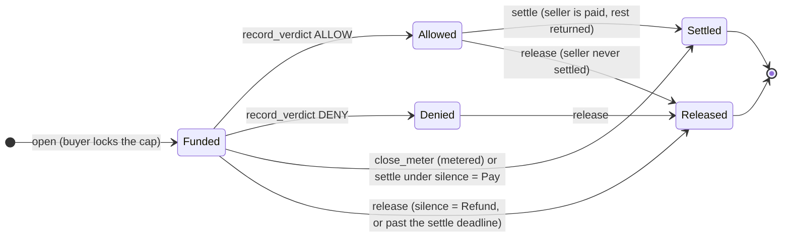

<p align="center">
  <picture>
    <source media="(prefers-color-scheme: dark)" srcset="brand/pactwright-logo-dark.svg">
    
  </picture>
</p>

<p align="center">
  <b>Escrow for AI-agent purchases on Stellar.</b><br>
  The buyer's money moves only when delivery is proven. Otherwise it comes back.
</p>

<p align="center">
  <a href="https://github.com/Pactwright/Pactwright-contracts/actions/workflows/ci.yml"></a>
  <a href="DEPLOYMENTS.md"></a>
  <a href="https://github.com/Pactwright/Pactwright-contracts/releases/tag/v0.1.0-rc.1"></a>
  <a href="docs/BENCHMARKS.md"></a>
  <a href="docs/SECURITY_MODEL.md"></a>
  <a href="LICENSE"></a>
</p>

<p align="center">
  <a href="#in-60-seconds-for-reviewers"><b>In 60 seconds</b></a> ·
  <a href="#verify-it-yourself"><b>Verify it yourself</b></a> ·
  <a href="#on-chain-evidence"><b>On-chain evidence</b></a> ·
  <a href="docs/ARCHITECTURE.md">Architecture</a> ·
  <a href="ROADMAP.md">Roadmap</a> ·
  <a href="https://github.com/Pactwright/Pactwright-Kit">SDK</a> ·
  <a href="https://github.com/Pactwright/Pactwright-studio">Studio</a>
</p>

<p align="center">
  <a href="https://scorecard.dev/viewer/?uri=github.com/Pactwright/Pactwright-contracts"></a>
</p>

> [!IMPORTANT]
> **Testnet only, not audited.** The `pact` contract is live on Stellar testnet and every number
> below links to a real transaction. Do not use it with real funds until the audit (ROADMAP P8-01).

| | |
|---|---|
| `pact` contract (testnet) | [`CDUXJJUN…MFEV6`](https://stellar.expert/explorer/testnet/contract/CDUXJJUNYFILEYHE3LITANJEKCDFERNAABOSG75OWATFVM776BCMFEV6) |
| Its WASM hash | `748b5dbc…5d1a4`, identical in the [release](https://github.com/Pactwright/Pactwright-contracts/releases/tag/v0.1.0-rc.1), on testnet and in a local build |
| Receipt anchor (testnet) | [`CAEO5GBC…LNJ2`](https://stellar.expert/explorer/testnet/contract/CAEO5GBC3ULRC5RYBSCSOXLNXHU2HZAHNW5HY5LZM3DIPFMX357ILNJ2), Accensa `ReceiptAnchor` v0.2.0 |
| Payment token | USDC ([`CBIELTK6…DAMA`](https://stellar.expert/explorer/testnet/contract/CBIELTK6YBZJU5UP2WWQEUCYKLPU6AUNZ2BQ4WWFEIE3USCIHMXQDAMA), Circle testnet) |
| Measured cost | [docs/BENCHMARKS.md](docs/BENCHMARKS.md): local and real-transaction numbers per call |
| Trust model | [docs/SECURITY_MODEL.md](docs/SECURITY_MODEL.md) |
| Design | [PRD](docs/PRD.md) · [Architecture](docs/ARCHITECTURE.md) · [15 ADRs](docs/adr/) |

## Contents

- [In 60 seconds, for reviewers](#in-60-seconds-for-reviewers)
- [The problem](#the-problem)
- [How it works](#how-it-works)
- [What the contract does today](#what-the-contract-does-today)
- [Verify it yourself](#verify-it-yourself)
- [On-chain evidence](#on-chain-evidence)
- [Stellar, specifically](#stellar-specifically)
- [What it costs](#what-it-costs)
- [Clone and run](#clone-and-run)
- [Layout](#layout)
- [Built on](#built-on)

## In 60 seconds, for reviewers

- **What it is.** A Soroban escrow for purchases an AI agent makes. The buyer locks a cap; a verifier's signed verdict (or the buyer's own signed usage, for metered services) decides how much the seller gets; the rest goes back to the buyer.
- **What runs today.** The contract on testnet, a release with a reproducible WASM, 86 contract tests and 4 tool tests in CI, fuzzing, budget tests and a real-transaction benchmark.
- **What makes it safe.** No admin can move funds. Two deadlines and a silence policy mean a missing verifier or seller can never strand the buyer's money. Each verdict is bound to one pact and one condition hash.
- **Check one claim yourself:** `scripts/build.sh` prints the WASM hash; compare it with the [release asset](https://github.com/Pactwright/Pactwright-contracts/releases/tag/v0.1.0-rc.1) and the [deployed contract](https://stellar.expert/explorer/testnet/contract/CDUXJJUNYFILEYHE3LITANJEKCDFERNAABOSG75OWATFVM776BCMFEV6). They are the same bytes.

## The problem

An agent can already pay for an API on Stellar with x402. What it can't do is get its money back when the delivery is wrong.

| Without Pactwright | With a pact |
|---|---|
| Money moves before anything is delivered | The cap sits in escrow until a verdict or signed usage |
| "Delivered" is whatever the seller's server says | A verifier checks the delivery against a condition frozen before payment |
| A wrong delivery needs the seller's goodwill to refund | DENY returns the escrow; no one's permission needed |
| A silent seller or verifier can hold funds forever | Deadlines and an agreed silence policy release funds automatically |
| Pay-per-minute services charge up front | The buyer signs cumulative usage; the seller is paid for exactly that |

## How it works



- **The verdict** is a compact attestation signed by the verifier, bound to the pact ID, the condition hash and a ledger inside the pact's life. Its full Witness-style envelope stays off-chain, linked by hash.
- **Metered pacts** skip the verifier: the buyer's SDK signs `UsageVoucher { pact_id, units }`, and the seller closes the meter with the latest one.
- **Receipts** for every outcome are batched into a Merkle tree and anchored in `ReceiptAnchor`, so anyone can verify a purchase offline or on-chain.

## What the contract does today

| Capability | Status |
|---|---|
| Escrow a capped purchase in USDC | Testnet |
| Verdict-gated settlement, partial amounts, single verdict per pact | Testnet |
| Pay-per-unit metering with signed usage vouchers | Testnet |
| Verdict and settle deadlines with a silence policy (refund or pay) | Testnet |
| Receipts anchored in `ReceiptAnchor` and verified against it | Tested (integration) |
| Admin cannot move funds or change an open pact | Tested (invariant 4) |
| Reproducible build: release = deployment = local build | Proven |
| Per-call cost limits enforced in CI and on real transactions | Proven |
| Mainnet | After the audit |

## Verify it yourself

Each line needs only this repo and the [stellar CLI](https://developers.stellar.org/docs/tools/cli) 28.1.0.

```bash
# 1. The tests: invariants, deadlines, fuzzing, integration, budgets
scripts/build.sh && cargo test

# 2. The build is reproducible: compare with the release asset and the deployed contract
scripts/build.sh                      # prints 748b5dbc…5d1a4
gh release download v0.1.0-rc.1 -R Pactwright/Pactwright-contracts -p '*.sha256' -O -

# 3. The deployed configuration (read-only simulation, no fees)
stellar contract invoke --network testnet --source <any-funded-identity> --send=no \
  --id CDUXJJUNYFILEYHE3LITANJEKCDFERNAABOSG75OWATFVM776BCMFEV6 -- get_config

# 4. Every hash and signature, byte for byte, against the published vectors
cargo test -p pact-sign
```

## On-chain evidence

A full purchase cycle on testnet, every step a real transaction (bench deployment, test token):

| Step | What happened | Transaction |
|---|---|---|
| `open` | Buyer locks 1.0 token in escrow | [`e782ba7a…`](https://stellar.expert/explorer/testnet/tx/e782ba7a347590e1c310a0d31dcd4632547b2140b1dc3204060be03a9390ab61) |
| `record_verdict` | Verifier-signed ALLOW recorded | [`8ed129b4…`](https://stellar.expert/explorer/testnet/tx/8ed129b4f2590330dea6e3c08c8f06c59a9687ec1a6a2ad046e0f63f7ed832a4) |
| `settle` | Seller paid 0.5, buyer refunded 0.5, in one transaction | [`52899433…`](https://stellar.expert/explorer/testnet/tx/52899433fce58051a2b5f7690849fc086e033fc6ee4b0b386b211529ff2f9ae4) |
| `release` | DENY on a second pact; full refund, no one's permission needed | [`214da9bc…`](https://stellar.expert/explorer/testnet/tx/214da9bc23b3cceb96fbc2c17b3c1ada9f02d91a126a73128b0d45b384b7b8c7) |
| `close_meter` | Metered pact: 500 units paid from a signed voucher, rest refunded | [`60409d84…`](https://stellar.expert/explorer/testnet/tx/60409d845346a18a066cc58ba8393d4a365a8f2e787afbde22268a3bfa26259a) |

Rerun it: `scripts/bench-testnet.sh --check` (or the manual `bench-testnet` workflow).

## Stellar, specifically

| Stellar feature | Line of code |
|---|---|
| USDC moved into escrow through the Stellar Asset Contract | [lifecycle.rs:62](https://github.com/Pactwright/Pactwright-contracts/blob/cd151bdf8bce48f9fe027eb64efee5fdd6f7ae27/contracts/pact/src/lifecycle.rs#L62) |
| `ed25519_verify` on the verifier's attestation | [verdict.rs:50](https://github.com/Pactwright/Pactwright-contracts/blob/cd151bdf8bce48f9fe027eb64efee5fdd6f7ae27/contracts/pact/src/verdict.rs#L50) |
| `ed25519_verify` on the buyer's usage voucher | [meter.rs:49](https://github.com/Pactwright/Pactwright-contracts/blob/cd151bdf8bce48f9fe027eb64efee5fdd6f7ae27/contracts/pact/src/meter.rs#L49) |
| Storage TTL extended past the settle window, so funds never sit in an archived entry | [lifecycle.rs:87](https://github.com/Pactwright/Pactwright-contracts/blob/cd151bdf8bce48f9fe027eb64efee5fdd6f7ae27/contracts/pact/src/lifecycle.rs#L87) |
| Deadlines checked against the network's `max_ttl` | [lifecycle.rs:47](https://github.com/Pactwright/Pactwright-contracts/blob/cd151bdf8bce48f9fe027eb64efee5fdd6f7ae27/contracts/pact/src/lifecycle.rs#L47) |
| Release pays only the buyer, with no auth required | [lifecycle.rs:176](https://github.com/Pactwright/Pactwright-contracts/blob/cd151bdf8bce48f9fe027eb64efee5fdd6f7ae27/contracts/pact/src/lifecycle.rs#L176) |
| Domain-separated digests (verdict, usage, delivery, receipt) | [hashing.rs:14](https://github.com/Pactwright/Pactwright-contracts/blob/cd151bdf8bce48f9fe027eb64efee5fdd6f7ae27/contracts/pact/src/hashing.rs#L14) |
| Typed events with `#[contractevent]` | [events.rs:17](https://github.com/Pactwright/Pactwright-contracts/blob/cd151bdf8bce48f9fe027eb64efee5fdd6f7ae27/contracts/pact/src/events.rs#L17) |

## What it costs

Measured on real testnet transactions ([BENCHMARKS.md](docs/BENCHMARKS.md)); fees in XLM:

| Call | CPU instructions | Fee |
|---|---|---|
| `open` | 1.07M | 0.0181 (includes storage rent) |
| `record_verdict` | 1.65M | 0.0009 |
| `settle` | 1.19M | 0.0012 |
| `release` | 1.03M | 0.0009 |
| `close_meter` | 2.04M | 0.0013 |

Every call stays under 2.1% of a transaction's 100M CPU limit. CI fails if a change pushes any
call past its recorded limit.

## Clone and run

```bash
git clone https://github.com/Pactwright/Pactwright-contracts.git && cd Pactwright-contracts
rustup show                 # pinned toolchain + wasm32v1-none
scripts/build.sh            # needs stellar-cli 28.1.0
cargo test                  # 90 tests: contract, fuzzing, integration, budgets, vectors
```

Deploying your own copy: [`scripts/deploy.sh`](scripts/deploy.sh) (refuses pubnet without an explicit confirmation).

## Layout

| Path | What |
|---|---|
| [`contracts/pact`](contracts/pact) | The escrow contract: `lifecycle.rs`, `verdict.rs`, `meter.rs`, `hashing.rs`, tests |
| [`test-vectors`](test-vectors) | The source of truth for every hash and signature, shared with the TypeScript SDK |
| [`tools/pact-sign`](tools/pact-sign) | Pact IDs and signatures from the contract's own hashing code |
| [`vendor/wasm`](vendor/wasm) | Pinned, hash-checked Accensa `ReceiptAnchor` and `RefundVault` |
| [`scripts`](scripts) | Build, deploy, bindings, release assets, testnet benchmark |
| [`docs`](docs) | PRD, architecture, ADRs, events, invariants, benchmarks, security model, runbook |
| [`DEPLOYMENTS.md`](DEPLOYMENTS.md) | Every deployment with provenance, including retired ones |

## Built on

[Accensa](https://github.com/accensa) (receipt anchoring, refund vault, x402 facilitator) ·
[Tollcraft](https://github.com/Tollcraft) (cost lint and budget tests) ·
[Witness](https://github.com/fabian416/witness) (verdict envelope format) ·
[Ficha](https://github.com/beto-rocha-blockchain/ficha-stellar) (refunding unused units) ·
[Vespi](https://github.com/andresanemic/vespi), [BookerBob](https://github.com/hustle1hustle/bookerbob-hackmeridian-2026)
and [Pollar](https://docs.pollar.xyz) (add-ons). Details in [NOTICE](NOTICE).

## Contributing

Read [CONTRIBUTING.md](CONTRIBUTING.md). **Every PR updates [ROADMAP.md](ROADMAP.md).**
Security reports: [SECURITY.md](SECURITY.md). License: [MIT](LICENSE).
